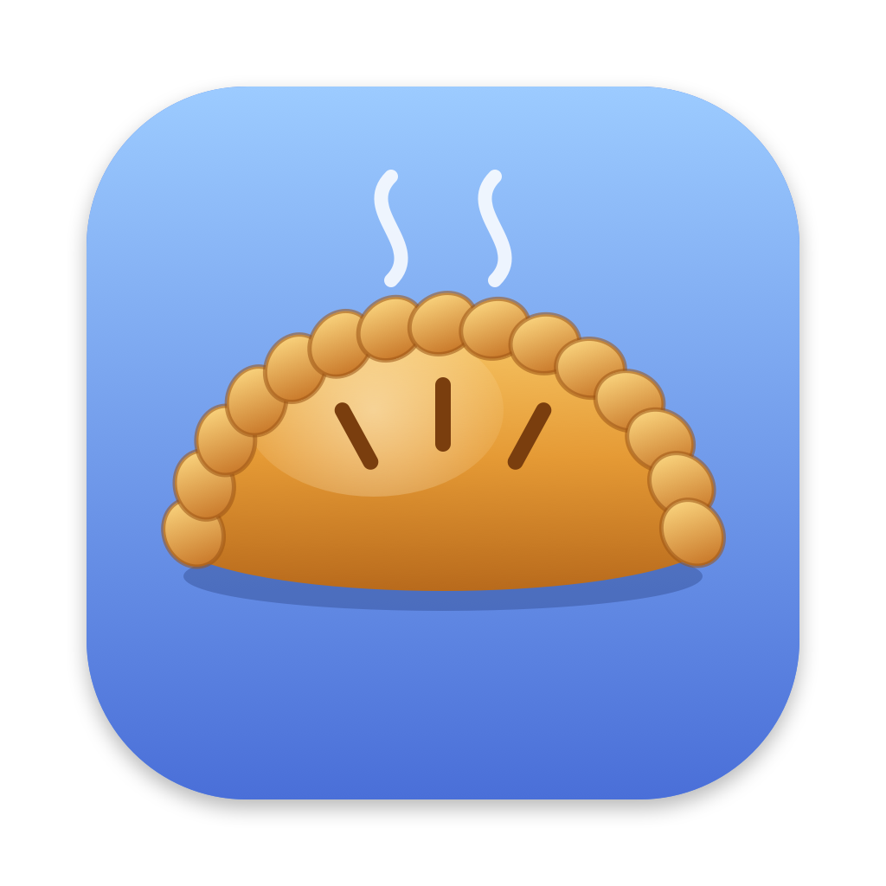

# Pastry

A small, native clipboard history app for macOS, made to work like **Win+V** on Windows.

Press **⇧⌘V** anywhere to bring up everything you've copied, search it, and paste any item back into the app you're using.

## Features

- **Pop-up history next to your cursor.** Type to search, use ↑ ↓ to move, and press ↩ to paste.
- **Quick paste:** ⌘1–⌘9 paste one of the first nine items directly.
- **Pinning:** ⌘P pins an item so it stays at the top and is never trimmed.
- **Handles text, images and screenshots, and files copied in Finder.**
- **History survives restarts.** It's saved to `~/Library/Application Support/Pastry/`.
- **Respects privacy markers.** Copies that password managers mark as concealed or transient (1Password and others) are never recorded.
- **Menu bar only:** no Dock icon. The menu has pause recording, history size (50–1000), launch at login, and a shortcut picker (⇧⌘V, ⌃⌘V, ⌥⌘V, ⇧⌘C).
- **Lightweight:** plain Swift, AppKit and SwiftUI, with no dependencies and no Xcode project.

## Install

### Download

1. Get **Pastry-vX.Y.Z.zip** from the [latest release](https://github.com/H3XY/Pastry/releases/latest) and unzip it.
2. Drag **Pastry.app** into your Applications folder and open it.
3. Allow **Accessibility** when asked, so Pastry can paste for you.

Releases are signed with Developer ID and notarized by Apple, so they open without warnings.

It runs on macOS 13 or later, on Apple Silicon and Intel Macs.

### Build from source

Requires macOS 13 or later and Xcode (or the Command Line Tools).

```bash
git clone https://github.com/H3XY/Pastry.git
cd Pastry
./build.sh --install
```

This builds `Pastry.app`, copies it to `~/Applications`, and launches it. Look for the pasty in your menu bar.

### Auto-paste permission

To paste straight into the app you're using, Pastry needs **Accessibility** access: System Settings → Privacy & Security → Accessibility → turn on Pastry. Without it, choosing an item only copies it to the clipboard and you press ⌘V yourself.

> `build.sh` signs the app with your Apple Development (or Developer ID) certificate if you have one, so the permission survives rebuilds. Without a certificate it falls back to an ad-hoc signature, which changes on every build: if auto-paste stops working after a rebuild, toggle Pastry off and on in that settings list.

## Keyboard shortcuts

| Key | Action |
| --- | --- |
| ⇧⌘V | Open or close Pastry (changeable from the menu bar) |
| ↑ / ↓ | Move the selection |
| ↩ | Paste the selected item |
| ⌘1 – ⌘9 | Paste item 1–9 |
| ⌘P | Pin or unpin |
| ⌘⌫ | Delete the item |
| esc | Close |

## How it works

| File | Role |
| --- | --- |
| `Sources/ClipboardMonitor.swift` | Checks `NSPasteboard.changeCount` every 0.4 s, because macOS has no clipboard-change notification |
| `Sources/ClipStore.swift` | Stores history and pins, saves it as JSON, and keeps images as PNG files |
| `Sources/HotKey.swift` | Global shortcut via Carbon `RegisterEventHotKey` (needs no permissions) |
| `Sources/PanelController.swift` | Non-activating floating panel, so the app you were typing in keeps focus, plus keyboard handling and the simulated ⌘V |
| `Sources/HistoryView.swift` | The SwiftUI list UI |
| `Sources/App.swift` | Menu bar item and settings |
| `Sources/MenuBarIcon.swift` | Draws the one-color pasty in the menu bar |
| `tools/make-icon.swift` | Draws the pasty app icon into `Resources/AppIcon.icns` (run `xcrun swift tools/make-icon.swift`) |

## Contributing

- `main` is the released code and `dev` is where work comes together.
- Do work on a feature branch, open a pull request into `dev`, and once `dev` is ready, open a pull request from `dev` into `main`.
- The **Build** workflow compiles the app on every pull request and on every push to `dev` and `main`.
- **Releasing:** bump `CFBundleShortVersionString` in `Info.plist` through the usual PRs, then on an up-to-date `main` run `./release.sh v1.2.3`. It builds a universal app, signs it with Developer ID, has Apple notarize it, then tags the commit and publishes the GitHub Release. The setup it needs is listed at the top of `release.sh`.

## Known limitations

- Rich text is stored as plain text, so formatting is lost when pasting from history.
- ⇧⌘V overrides "Paste and Match Style" in apps that use it, such as Google Docs and Slack. Pick another shortcut from the menu if that matters to you.
